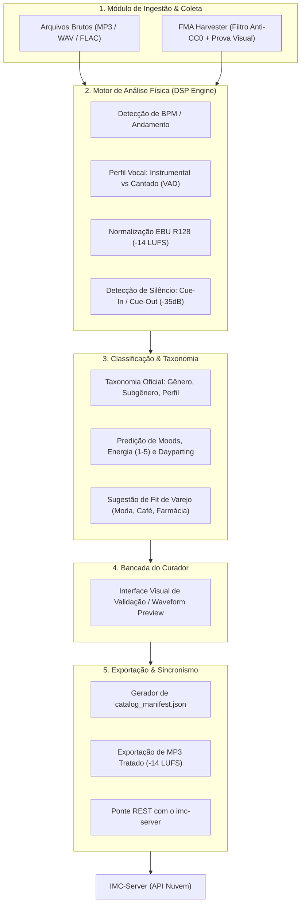

# Plano de Implementação - Inicialização do Projeto `imc-music-studio`

Criação e estruturação do novo repositório e aplicação **`imc-music-studio`**, uma suíte profissional dedicada à curadoria, análise física (DSP), classificação inteligente (IA), normalização de áudio e exportação de catálogos para o **`imc-server`**, garantindo total isolamento de processamento e zero concorrência de CPU no servidor de streaming.

---

## User Review Required

> [!IMPORTANT]
> - O **`imc-music-studio`** será criado em `/home/paulo-assis/imc-music-studio` como um repositório Git independente.
> - O projeto utilizará **Python 3** com bibliotecas de áudio (`librosa`/`aubio`, `ffmpeg-python`, `mutagen`, `pydub`, `soundfile`, `scipy`) e integração opcional com IA para sugestão de Moods e Fit de Varejo.
> - A saída principal do estúdio será o par: **Arquivos MP3 normalizados a -14 LUFS** + **`catalog_manifest.json`** estruturado, prontos para ingestão em 1 clique no `imc-server`.

---

## Arquitetura e Módulos do `imc-music-studio`

---

## Proposed Changes

### Estrutura do Novo Projeto: `/home/paulo-assis/imc-music-studio`

#### [NEW] [README.md](file:///home/paulo-assis/imc-music-studio/README.md)
Documentação oficial do projeto, arquitetura, guia de instalação e comandos da CLI.

#### [NEW] [requirements.txt](file:///home/paulo-assis/imc-music-studio/requirements.txt)
Dependências do ecossistema Python (DSP, áudio, extração de metadados e interface).

#### [NEW] [config.yaml](file:///home/paulo-assis/imc-music-studio/config.yaml)
Configurações do estúdio (diretórios de entrada/saída, parâmetros de normalização -14 LUFS, limiares de silêncio -35dB e endpoint de conexão com o `imc-server`).

#### [NEW] [cli.py](file:///home/paulo-assis/imc-music-studio/cli.py)
Interface de linha de comando com comandos:
* `analyze <pasta>`: Analisa BPM, loudness, cues e perfil vocal de arquivos.
* `process <pasta>`: Normaliza faixas a -14 LUFS e exporta MP3s tratados.
* `tag <pasta>`: Sugere e aplica tags de taxonomia (Mood, Energia, Fit).
* `harvest-fma`: Coleta músicas comerciais com comprovantes jurídicos.
* `export <pasta>`: Gera o manifesto final `catalog_manifest.json`.
* `sync <pasta>`: Envia o lote tratado diretamente para o `imc-server`.

#### [NEW] `studio/core/taxonomy.py`
Definição dos enums e estruturas oficiais de taxonomia:
* **Macro-Gêneros**: Pop, Dance/Eletrônica, Jazz & Blues, MPB & Bossa Nova, Rock & Indie, R&B/Soul, Folk/Acústico.
* **Perfil Vocal**: `Instrumental Puro`, `Vocal Feminino`, `Vocal Masculino`, `Dueto`, `Chopped/Samples`.
* **Moods**: `Ensolarado`, `Elegante`, `Relaxante`, `Descontraído`, `Urbano`, `Vibrante`, `Sofisticado`, `Romântico`.
* **Energia**: Escala 1 a 5.
* **Fit de Varejo**: `Moda Jovem`, `Moda Feminina`, `Cafeteria`, `Restaurante`, `Farmácia`, `Supermercado`, `Academia`.

#### [NEW] `studio/core/audio_analyzer.py`
Extração automatizada de características físicas do áudio:
* Detecção de BPM com `librosa` / `aubio` / `scipy`.
* Análise EBU R128 (LUFS Integrado, LRA, True Peak).
* Detecção de silêncio no início e fim para cálculo de `cue_in` e `cue_out`.

#### [NEW] `studio/core/vocal_analyzer.py`
Algoritmo de detecção de atividade vocal (VAD) para classificar faixas como `Instrumental` ou `Vocal`.

#### [NEW] `studio/core/audio_normalizer.py`
Motor de normalização e corte de áudio via `ffmpeg-python`, gerando os arquivos MP3 de alta fidelidade prontos.

#### [NEW] `studio/harvester/fma_harvester.py` & `studio/harvester/license_manager.py`
Migração e modernização das ferramentas de colheita FMA com comprovantes visuais e JSONs estruturados.

#### [NEW] `studio/exporter/manifest.py` & `studio/exporter/server_client.py`
Gerador do `catalog_manifest.json` e cliente HTTP de publicação para o `imc-server`.

---

## Verification Plan

### Automated Tests
1. **Teste de Inicialização**:
   - Inicializar repositório Git em `/home/paulo-assis/imc-music-studio`.
   - Criar ambiente virtual Python e validar importação dos módulos principais.
2. **Teste de Análise de Áudio (DSP)**:
   - Executar `cli.py analyze` sobre faixas de teste e validar cálculo de BPM, LUFS e Cue Points.
3. **Teste de Normalização**:
   - Processar áudio de teste e validar se o arquivo gerado atinge exatamente -14 LUFS.
4. **Teste de Geração de Manifesto**:
   - Validar se o `catalog_manifest.json` gerado segue 100% a taxonomia multidimensional.

### Manual Verification
- Testar execução de comandos da CLI (`analyze`, `tag`, `export`).
- Validar saída dos arquivos tratados e documentação.
