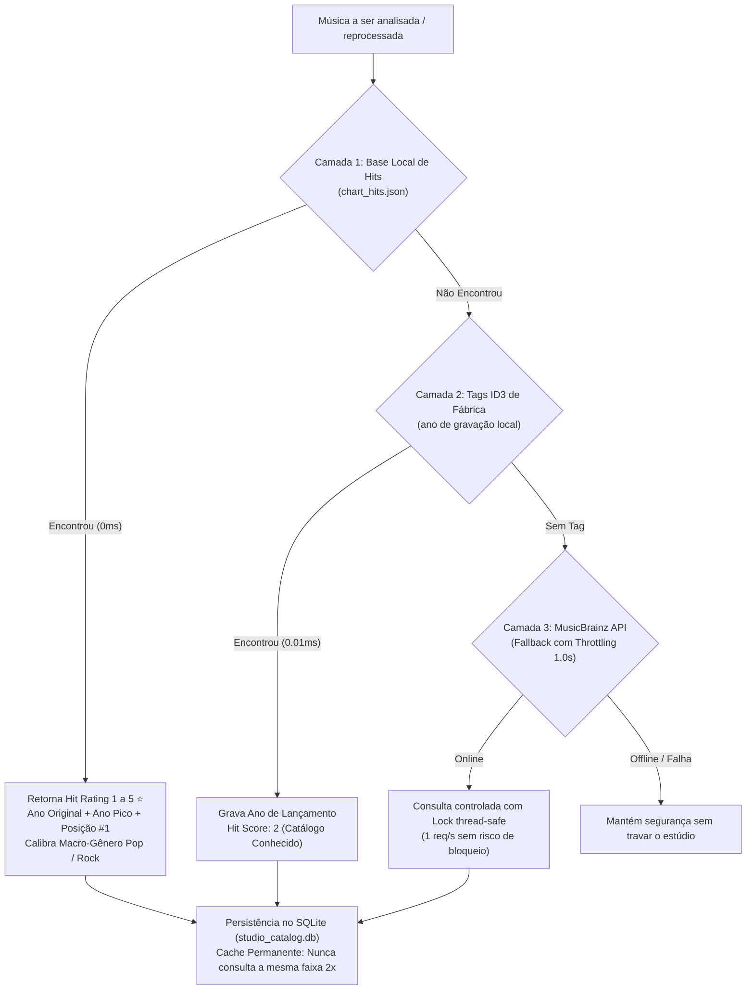

# Inteligência de Mercado: Ano de Lançamento, Hit Rating & Escopo de Reprocessamento

Foi implementado com sucesso o módulo completo de **Inteligência de Mercado e Histórico de Paradas Musicais** no **IMC Music Studio**, atendendo plenamente à necessidade de identificar anos de lançamento, anos de sucesso comercial, classificação de hits (1⭐ a 5⭐) e calibrar gêneros comerciais de grandes clássicos como *Céline Dion - My Heart Will Go On (Titanic)*.

---

## 1. Arquitetura de Consulta e Solução para Restrições de Tempo (APIs)

### O Desafio de Consultar APIs Externas
APIs abertas de metadados como a **MusicBrainz** possuem restrições técnicas e jurídicas rígidas de *Rate Limiting*:
- Limite máximo de **1 requisição por segundo** por IP.
- Se o estúdio consultar 500 músicas de uma vez via rede, o processo levaria mais de 8 minutos ou o IP seria bloqueado (`HTTP 429 Too Many Requests`).
- Em ambientes fechados ou offline (sem internet), requisições externas falham imediatamente.

### A Solução: Arquitetura Híbrida em 3 Camadas (0ms a 1s)



1. **Camada 1 (Base Local de Hits - 0ms, 100% Offline)**:
   - Base curada em [`studio/data/chart_hits.json`](file:///home/paulo-assis/imc-music-studio/studio/data/chart_hits.json) contendo os maiores clássicos das rádios (Billboard Hot 100 #1, UK Singles, MPB, Rock Nacional, Flashbacks dos anos 70, 80, 90 e 2000).
   - Suporta busca exata, aliases (ex: `"Titanic"` para `"My Heart Will Go On"`) e busca por título isolado quando o artista for genérico ou coletânea (ex: *"Década Explosiva Romântica"*).
2. **Camada 2 (Tags ID3 Locais - 0.01ms)**:
   - Extrai o ano gravado no cabeçalho do próprio arquivo MP3 (`date`, `year`, `originaldate`).
3. **Camada 3 (MusicBrainz API com Throttling Thread-Safe)**:
   - Implementado em [`studio/core/catalog_enricher.py`](file:///home/paulo-assis/imc-music-studio/studio/core/catalog_enricher.py) com controle estrito via `threading.Lock` garantindo no mínimo 1.0 segundo entre chamadas, evitando qualquer sobrecarga ou bloqueio.
4. **Cache Permanente em SQLite**:
   - Assim que uma faixa é enriquecida, os dados de mercado são salvos em `studio_catalog.db`. Consultas subsequentes demoram **0ms**.

---

## 2. Item Integrado no Modal de Reprocessamento

O item **"Ano de Lançamento & Hit Rating (Paradas)"** foi adicionado como módulo selecionável em todo o sistema:

* **Reprocessamento Individual**: Disponível no botão *"Reprocessar"* com seleção granular.
* **Reprocessamento em Lote**: Permite marcar apenas o escopo `catalog_hits` para reavaliar uma pasta inteira de centenas de músicas rapidamente.
* **Reprocessamento Automático no Scan**: Faixas sem inteligência de mercado aberta no player são auto-enriquecidas instantaneamente.

---

## 3. Calibração Cultural de Macro-Gênero (Caso Titanic / Céline Dion)

Músicas como *My Heart Will Go On* eram anteriormente classificadas puramente pela matemática espectral como *Folk & Acústico* por causa da introdução de flauta celta.

Com o novo `CatalogEnricher`:
- O sistema detecta que a faixa é um **Mega Hit Mundial (#1 Billboard)**.
- O Macro-Gênero é calibrado para **Pop**.
- Os Subgêneros recomendados são ajustados para **Pop Romântico** e **Trilha Sonora**.
- O Hit Rating é definido com a nota máxima: **5⭐ (Mega Hit Mundial)**.

---

## 4. Modificações na Interface Gráfica

1. **Card de Inteligência de Mercado** ([index.html](file:///home/paulo-assis/imc-music-studio/studio/ui/templates/index.html) e [style.css](file:///home/paulo-assis/imc-music-studio/studio/ui/static/style.css)):
   - Visualização do **Ano de Lançamento** e **Ano de Pico**.
   - Badge dinâmico de década (ex: `Anos 90`, `Anos 80`, `Anos 70`, `Anos 2000`).
   - Seletor interativo de estrelas de **Hit Rating (1⭐ a 5⭐)** com feedback descritivo (*Mega Hit #1*, *Grande Hit Top 10*, *Top 40 / Rádio*, etc.).
   - Histórico oficial de paradas (ex: *"Billboard Hot 100 #1 (1998) • 18M+ cópias • Oscar & Grammy"*).
2. **Lista de Faixas**:
   - Badges visuais de ano (ex: `1997`) e estrela dourada `★ HIT` para rápida identificação pelo curador.
3. **Persistência Completa**:
   - Edições manuais feitas pelo curador nos campos de mercado são salvas no banco de dados via `/api/save-track`.

---

## 5. Validação e Testes Automatizados

Executada a suíte de testes unitários com **100% de aprovação**:

| Teste | Descrição | Resultado |
|---|---|---|
| `test_local_charts_exact_match` | Match exato de artista e título (*Céline Dion - My Heart Will Go On*) | ✅ Aprovado |
| `test_local_charts_alias_match` | Match por alias (*Celine Dion - Titanic*) | ✅ Aprovado |
| `test_local_charts_title_only_compilation` | Match por título isolado em coletânea | ✅ Aprovado |
| `test_local_charts_brazilian_hits` | Hits brasileiros (*Legião Urbana*, *Tim Maia*) | ✅ Aprovado |
| `test_enrich_track_structure` | Estrutura de retorno completa (*A-ha - Take On Me*) | ✅ Aprovado |
| `test_reprocess_api_catalog_hits_scope` | Endpoint `/api/analyze-track` com escopo `catalog_hits` | ✅ Aprovado |
| `test_save_track_market_intel_persistence` | Gravação e persistência de dados de mercado no SQLite | ✅ Aprovado |
| `tests/test_reprocess.py` | Reprocessamento com métricas SONIC e normalização | ✅ Aprovado |
| `tests/test_vocal_classifier.py` | Classificação de perfis vocais | ✅ Aprovado |
| `tests/test_language_detector.py` | Detecção de idiomas da letra | ✅ Aprovado |
| `tests/test_metadata_parser.py` | Higienização de artistas numéricos e padrões de arquivos | ✅ Aprovado |
| `tests/test_subgenre_tagger.py` | Classificação MIR de subgêneros | ✅ Aprovado |


---

## 6. Redesenho Ergonômico de Layout: Eliminação da Coluna Direita

Atendendo ao feedback de usabilidade, a coluna lateral direita (anteriormente com 380px comprimidos) foi completamente removida e todos os seus blocos de inspeção e curadoria foram reorganizados horizontalmente logo abaixo do waveform player e do simulador de transições no centro da tela.

### Arquitetura do Novo Layout (2 Painéis Widescreen)

```
+---------------------+-------------------------------------------------------------------------+
| PAINEL ESQUERDO     | WORKBENCH CENTRAL (FULL WIDTH)                                          |
| (330px)             | (75% a 80% da tela)                                                     |
+---------------------+-------------------------------------------------------------------------+
| [Pasta de Origem]   | [Banner da Faixa: Título, Artista, BPM, Formato Vocal, Tamanho]         |
|                     | [Waveform Card: Canvas largo, Cues In/Out arrastáveis, Transport Player] |
| [Busca & Filtros]   | [Simulador de Transições no Ar (Audition Suite: Entrada, Saída, Parar)] |
|                     |                                                                         |
| [Lista de Faixas:   | GRID HORIZONTAL DE CURADORIA & DSP (Abaixo do Simulador):               |
|  Status, Duração,   | +-----------------------+-----------------------+---------------------+ |
|  BPM, Score,        | | COLUNA 1:             | COLUNA 2:             | COLUNA 3:           | |
|  Ano, Selo HIT]     | | Preenchimento Sonoro  | Taxonomia Musical     | Contexto de Varejo  | |
|                     | | (Score + Selo SONIC   | (Macro-gênero,        | (Moods, Retail Fit, | |
|                     | |  + 6 Métricas DSP)    |  MIR % IA + Subgêneros|  Dayparting, Notas) | |
|                     | | Inteligência Mercado  |  Vocal + Idioma       |                     | |
|                     | | (Ano, Pico, Hit 1-5⭐)|  Nível de Energia)    | [APROVAR & PRÓXIMA] | |
|                     | |                       |                       | [Rejeitar|Lote|Rep.]| |
|                     | +-----------------------+-----------------------+---------------------+ |
+---------------------+-------------------------------------------------------------------------+
```

### Vantagens Práticas:
1. **Visão Panorâmica sem Rolagem Comprimida**: O curador não precisa mais rolar uma barra lateral apertada para preencher metadados; todos os cards ficam dispostos lado a lado.
2. **Waveform Expandida**: O visualizador do waveform canvas ganhou amplitude horizontal completa, permitindo ajustes de `Cue In` e `Cue Out` com precisão milimétrica.
3. **Responsividade Inteligente**: Em monitores ultra-wide ou Full HD (`>= 1360px`), exibe as 3 colunas em paralelo. Em telas menores (`< 1360px`), agrupa em 2 colunas equilibradas automaticamente.
4. **Botão de Aprovação em Destaque**: O botão de aprovação e atalho de teclado `Enter` ficam prontamente visíveis na coluna de contexto e governança.

---

## 7. Alinhamento de Masterização Mono (`-ac 1`) com IMC-Server (Padrão de Varejo SONIC)

O pipeline de exportação e normalização do **IMC Music Studio** foi ajustado para exportar faixas em **Mono (1 canal)** por padrão, em perfeita paridade com o algoritmo de masterização do **`imc-server`** (`MasterizeAudio` / `utils.ExtractMetadata`):

### Motivação Acústica e de Varejo:
* Em sistemas de sonorização ambiente de lojas, supermercados e clínicas, as caixas de som no teto (arandelas) operam distribuídas em linha monaural. Faixas em estéreo causam cancelamento de fase ou fazem o cliente ouvir apenas instrumentos panorâmicos sem a voz principal dependendo da caixa sob a qual estiver.
* Redução de 50% de banda e tráfego de streaming para os terminais remotos do IMC Player.

### Alterações Técnicas:
1. **[`studio/core/audio_normalizer.py`](file:///home/paulo-assis/imc-music-studio/studio/core/audio_normalizer.py)**:
   - Adicionado parâmetro `channels: int = 1` no construtor de `AudioNormalizer`.
   - Adicionado parâmetro opcional `channels: Optional[int] = None` em `process_and_export`.
   - Inserida a flag `-ac <target_channels>` no comando do FFmpeg.
2. **Validação Automatizada com `ffprobe` ([`tests/test_reprocess.py`](file:///home/paulo-assis/imc-music-studio/tests/test_reprocess.py))**:
   - O teste automatizado de exportação e corte de cues agora verifica via `ffprobe -show_entries stream=channels` se o arquivo gerado possui rigorosamente `channels=1` (Mono).
   - Teste aprovado com sucesso em conjunto com toda a suíte de testes.

---

## 8. Esteira de Curadoria em 3 Etapas (`audio_in` ➔ `audio_analise` ➔ `audio_out`) & Aprovação Direta

Implementada a separação física do acervo em 3 fases, com status formais no SQLite e fluxo de aprovação imediata:

```
┌─────────────────┐       ┌─────────────────┐       ┌─────────────────┐
│   audio_in/     │ ───►  │  audio_analise/ │ ───►  │   audio_out/    │
│  (Arquivos      │       │ (Normalizada    │       │  (Faixa final   │
│    Brutos)      │       │  Mono -14 LUFS, │       │   Selo SONIC,   │
│                 │       │  Cues cortados) │       │   Pronta p/ Ar) │
│ Status: PENDENTE│       │Status: EM ANÁLISE│      │ Status: APROVADO│
└─────────────────┘       └─────────────────┘       └─────────────────┘
```

### Principais Benefícios:
1. **Auditoria Humana do Áudio Realmente Tratado**:
   * O curador escuta no player e visualiza na waveform exatamente o arquivo físico tratado com Mono, corte de Cues e limitador em `audio_analise/`.
2. **Aprovação Instantânea (Zero Re-encoding)**:
   * Ao clicar em **"Aprovar & Próxima Faixa"**, o sistema não reprocessa nada: apenas promove o arquivo físico já inspecionado para `audio_out/` e grava o status `Aprovado` no SQLite.
3. **Novos Filtros e Atalhos Rápidos**:
   * Atalho de um clique para `audio_analise` na barra de navegação de pastas.
   * Nova pílula de filtro **"Em Análise"** na lista lateral de faixas.
   * Novo contador estatístico azul no topo: **"Em Análise"**.
4. **Tratamento Individual Dirigido**:
   * O botão de tratamento individual passa a normalizar diretamente para `audio_analise/`, marcando a faixa como `Em Análise`.

---

## 9. Duração Efetiva Baseada em Cues e Validação para Som Ambiente (2 a 5 minutos)

Implementada a regra de que o tempo musical para programação de rádio corporativa é determinado pelos pontos de corte de transição:
$$\text{effective\_duration\_seconds} = \max(0.0, \text{cue\_out} - \text{cue\_in})$$

* **Validação de Conformidade**: Faixas aptas devem ter tempo útil entre **120s e 300s** (2 a 5 minutos).
* **Feedback Visual em Tempo Real**: Ao arrastar os marcadores verticais no waveform canvas, a interface recalcula a duração útil, atualiza a badge no topo e a indicação na lista lateral sem necessidade de salvar previamente.

---

## 10. Preenchimento Sonoro e Aptidão no Trecho Musical Útil

* O `sound_fullness_score` (0 a 100) e a `ambience_fitness` (`Apto`, `Atenção`, `Inapto`) agora são calculados estritamente sobre a fatia útil de áudio entre `cue_in` e `cue_out`.
* Silêncios de início/fim e ruídos de fade não distorcem mais o score espectral da música.

---

## 11. Classificador Vocal Multi-Janela & Ortogonalidade de Idioma

* **Amostragem em 3 Janelas**: Corrige a limitação da amostragem em janela única fixa (que classificava músicas com introdução longa ou solo instrumental como `Instrumental Puro`). Agora, 3 janelas estratégicas (15%, 45% e 70% do tempo) são inspecionadas, combinando crista de formantes vocais (900 a 3200 Hz via STFT) e rastreamento melódico de pitch ($f_0$ via YIN).
* **Ortogonalidade**: A detecção de idioma (Inglês, Português, Espanhol, Alemão) é ativada dinamicamente quando há vocal (`Vocal Feminino`, `Vocal Masculino`, `Dueto`) e travada como `Instrumental` para faixas instrumentais puras.

---

## 12. Sugestão Comparativa de Taxonomia (Opção A vs. Opção B) & Atalhos ⟳

* **Opção A (MIR Acústico)**: Baseada em análise física e espectral de áudio.
* **Opção B (Catálogo & Paradas)**: Baseada em histórico de charts, paradas internacionais e MusicBrainz.
* **Adoção com 1 Clique**: O curador escolhe a melhor opção e o sistema atualiza em cascata os subgêneros e as recomendações de varejo.
* **Botões de Reanálise (⟳)**: Cada card funcional possui botão individual no cabeçalho para reprocessar apenas o escopo desejado sem reanalisar o áudio inteiro.

---

## 13. Registro do BPM para o Playout Inteligente do IMC Player

* O andamento rítmico (BPM) aferido é registrado persistentemente na coluna `bpm` do SQLite (`studio_catalog.db`), no `audio_spec` e no `catalog_manifest.json`.
* Suporta a futura integração de *dayparting rítmico*, *BPM matching* de transição suave e seleção de ritmo por segmento de loja no IMC Player.

---

## 14. Acesso em Rede Multi-Dispositivo (`0.0.0.0:5050`)

* Servidor configurado para vincular em todas as interfaces de rede (`0.0.0.0:5050`), exibindo no console o IP da máquina local (`192.168.15.109:5050`) para acesso simultâneo por múltiplos computadores da rede interna.


